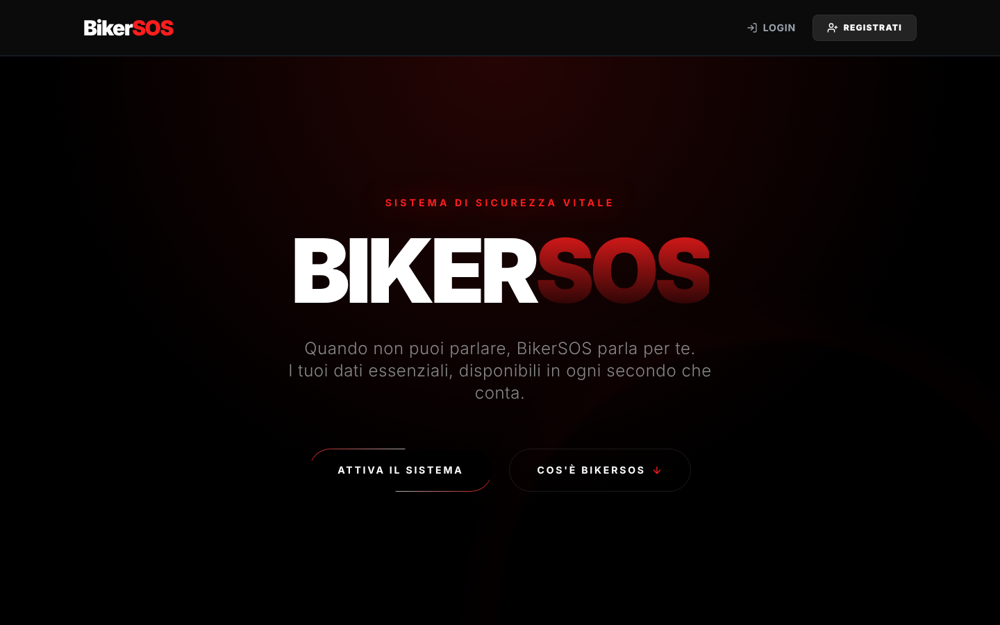
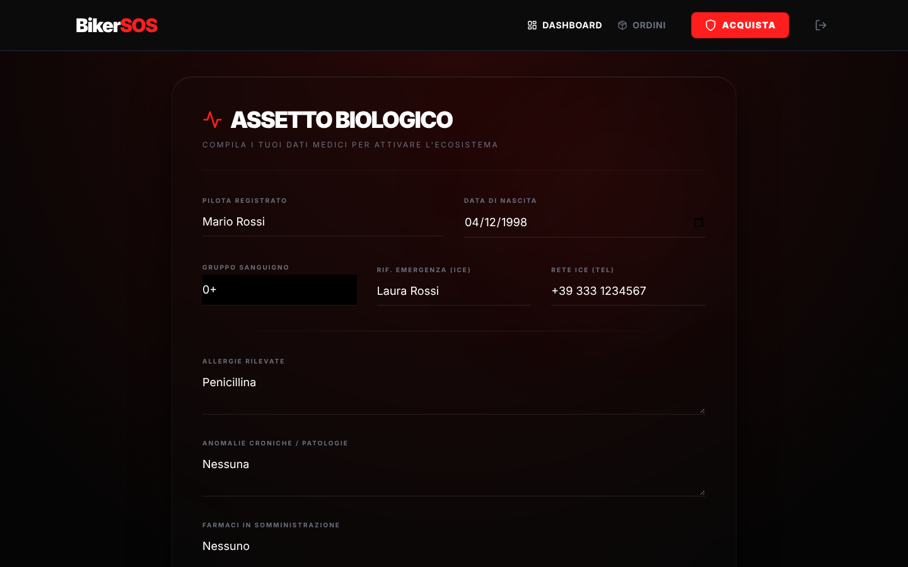
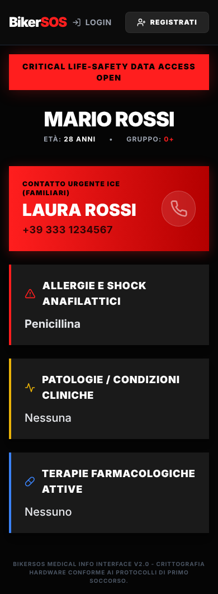

# BikerSOS

Piattaforma web per la sicurezza dei motociclisti. Ogni utente compila un profilo con i propri dati sanitari essenziali e i contatti di emergenza. Il profilo è collegato a un bracciale NFC: in caso di incidente, i soccorritori avvicinano uno smartphone al bracciale e aprono una pagina pubblica con le informazioni utili, senza dover installare alcuna app.

Il sito comprende anche la vendita del bracciale tramite Stripe Checkout e la gestione degli ordini.



## Funzionalità

- **Account utente**: registrazione, login con token firmato HMAC-SHA256, recupero password via email con link a scadenza (15 minuti).
- **Dashboard del profilo**: nome, data di nascita, gruppo sanguigno, allergie, patologie, terapie in corso e contatto ICE (*In Case of Emergency*).
- **Pagina di emergenza pubblica** (`/emergency/:uuid`): espone solo i campi utili ai soccorritori. L'identificativo è un UUID v4 casuale, scritto sul chip NFC.
- **Acquisto del bracciale**: sessione Stripe Checkout con raccolta dell'indirizzo di spedizione; il webhook `checkout.session.completed` registra l'ordine nel database.
- **Storico ordini** consultabile dall'utente.
- **Email transazionali** (benvenuto, conferma ordine, reset password) inviate via SMTP.

| Dashboard | Pagina di emergenza (mobile) |
| --- | --- |
|  |  |

*Gli screenshot mostrano dati di prova.*

## Stack

| Livello | Tecnologie |
| --- | --- |
| Frontend | React 18, React Router, Tailwind CSS, icone Lucide, build con Vite |
| Backend | PHP 8 (senza framework), PDO |
| Database | PostgreSQL (ospitato su Neon) |
| Pagamenti | Stripe Checkout + webhook firmati |
| Hosting | Apache con `mod_rewrite` (IONOS) |

## Struttura

```
.
├── backend/
│   ├── index.php            # API REST: routing, autenticazione, Stripe, email
│   ├── config.example.php   # modello di configurazione (credenziali escluse dal repo)
│   └── .htaccess            # inoltra tutte le richieste a index.php
├── database/
│   └── schema.sql           # tabelle users, profiles, orders
├── frontend/                # build di produzione della SPA React
│   ├── index.html
│   ├── assets/
│   └── .htaccess            # fallback su index.html per il routing lato client
└── docs/screenshots/
```

> Il codice sorgente del frontend (progetto Vite/React) non è incluso in questo repository: la cartella `frontend/` contiene la build pronta per il deploy.

## API

| Metodo | Endpoint | Auth | Descrizione |
| --- | --- | --- | --- |
| POST | `/api/auth/register` | – | Crea utente e profilo, restituisce il token |
| POST | `/api/auth/login` | – | Restituisce il token di sessione (24 h) |
| GET | `/api/profile` | Bearer | Profilo dell'utente autenticato |
| PUT | `/api/profile` | Bearer | Aggiorna il profilo |
| GET | `/api/emergency/:uuid` | – | Dati pubblici di emergenza |
| GET | `/api/orders` | Bearer | Ordini dell'utente |
| POST | `/api/create-checkout` | Bearer | Crea una sessione Stripe Checkout |
| POST | `/api/webhook` | firma Stripe | Registra l'ordine a pagamento completato |
| POST | `/api/forgot-password` | – | Invia il link di reset via email |
| POST | `/api/reset-password` | token di reset | Imposta la nuova password |

## Installazione

Requisiti: PHP 8 con estensioni `pdo_pgsql` e `curl`, PostgreSQL, un account Stripe e una casella SMTP.

1. Creare le tabelle:
   ```bash
   psql "$DATABASE_URL" -f database/schema.sql
   ```
2. Configurare il backend:
   ```bash
   cp backend/config.example.php backend/config.php
   ```
   e compilare credenziali del database, `JWT_SECRET`, chiavi Stripe e SMTP.
3. Avvio in locale:
   ```bash
   php -S localhost:8000 backend/index.php
   ```
4. In produzione, pubblicare `backend/` sul sottodominio delle API e `frontend/` sulla root del sito, poi registrare su Stripe il webhook `https://<api>/api/webhook` per l'evento `checkout.session.completed`.

## Note di sicurezza

- Password salvate con bcrypt; tutte le query usano prepared statement.
- I token vengono verificati (firma con confronto a tempo costante e scadenza) a ogni richiesta autenticata; i token di reset non sono accettati come token di sessione.
- Il webhook verifica la firma Stripe e scarta eventi con timestamp più vecchi di 5 minuti.
- Le credenziali risiedono in `backend/config.php`, escluso dal versionamento.
